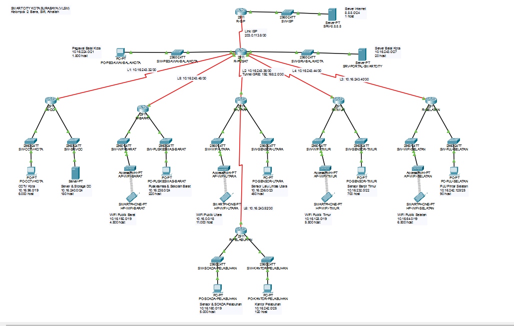

# midproject_k02_008_023_071
## Anggota Kelompok

| Nama | NRP |
| :--- | :--- |
| Barra Ahza Fakhrullah | 5027251023 |
| Silfi Rochmatul AuliyH | 5027251008 |
| Muhammad Atallah Mas'udi | 5027251071 |

---

## Dokumentasi & Output

### 1. desain topologi

Alur desain topologi ini disusun berurutan dari atas ke bawah, mulai dari R-ISP dan server internet 8.8.8.8 di paling atas sebagai pintu masuk internet, turun ke R-PUSAT di Balai Kota sebagai pusat jaringan, lalu bercabang ke lima router wilayah (R-DC, R-BARAT, R-UTARA, R-TIMUR, dan R-SELATAN), hingga turun lagi dari R-UTARA ke R-PELABUHAN di bagian paling bawah, di mana setiap router terhubung ke switch dan satu perangkat perwakilan untuk masing-masing jaringan. Untuk sambungan antar-router digunakan kabel merah berbentuk petir (kabel Serial) bukan kabel LAN lurus biasa, karena kabel petir memang dipakai untuk menghubungkan router jarak jauh antar-gedung/wilayah dan jumlah colokan LAN bawaan pada router terbatas (hanya 3 port), sehingga ditambahkan kartu port Serial (HWIC-2T) agar semua cabang dari R-PUSAT bisa terpasang sekaligus membedakan jalur utama antar-router dengan jalur LAN lokal. Sementara itu, untuk jalur LAN ke kantor, server, CCTV, dan sensor digunakan kabel LAN lurus biasa melalui switch supaya sambungannya stabil, sedangkan khusus empat area WiFi Publik dipasang Access Point karena router dan switch tidak memiliki pemancar WiFi bawaan, sehingga jaringan bisa dipancarkan secara wireless (tanpa kabel) layaknya WiFi umum. Sebagai perangkat penggunanya di jaringan WiFi tersebut dipilih Smartphone karena paling menggambarkan pengguna WiFi publik di lapangan dan sudah memiliki penerima WiFi bawaan, berbeda dengan PC atau server yang memang lebih pas terhubung dengan kabel.


# Dokumentasi Soal 3, 4, dan 5 — Kelompok 2

## 3. Static Routing

Static routing menghubungkan jaringan antarwilayah secara manual. R-PUSAT dan R-UTARA memiliki rute ke LAN di bawahnya, sedangkan default route mengarah ke atas atau keluar.

### Pemeriksaan awal routing R-UTARA


R-UTARA memiliki rute static menuju dua LAN Pelabuhan melalui 10.16.243.54. Default route diarahkan ke R-PUSAT melalui 10.16.243.37. Jaringan WiFi dan sensor Utara terhubung langsung ke router.

### Tabel routing R-PUSAT


R-PUSAT memiliki rute static menuju LAN DC, Utara, Pelabuhan, Selatan, Timur, dan Barat. Default route menuju 203.0.113.10 mengarahkan trafik keluar ke R-ISP ketika tidak ada rute yang lebih spesifik. Huruf S menunjukkan static route, sedangkan C menunjukkan jaringan connected.

### Tabel routing R-UTARA


Dua jaringan Pelabuhan, 10.16.160.0/19 dan 10.16.242.0/25, diarahkan melalui 10.16.243.54. Default route menuju 10.16.243.37 menunjukkan bahwa rute umum mengarah ke router di atasnya, yaitu R-PUSAT.

### Default route R-PELABUHAN


R-PELABUHAN terhubung langsung dengan LAN SCADA dan Kantor Pelabuhan. Untuk tujuan di luar jaringan connected, default route mengarah ke R-UTARA melalui 10.16.243.53, sesuai ketentuan arah default route.

### Ping menuju Kantor Pelabuhan


Ping ke 10.16.242.2 menerima empat balasan dari empat paket yang dikirim, dengan packet loss 0%. Hasil ini membuktikan perangkat sumber dapat berkomunikasi dengan perangkat Kantor Pelabuhan pada saat pengujian. Jalur sumber diperjelas oleh traceroute berikutnya.

### Traceroute menuju Kantor Pelabuhan


Traceroute ke 10.16.242.2 melewati gateway Balai Kota 10.16.224.1, R-UTARA 10.16.243.38, dan R-PELABUHAN 10.16.243.54 sebelum mencapai tujuan. Urutan ini sesuai jalur Balai Kota → R-PUSAT → R-UTARA → R-PELABUHAN → PC Kantor Pelabuhan.

### Ping menuju Puskesmas/Sekolah Barat


Ping ke 10.16.238.2 memperoleh empat balasan dan packet loss 0%. Bukti ini menunjukkan komunikasi menuju perangkat pada LAN Puskesmas/Sekolah Barat berhasil saat diuji.

### Traceroute menuju wilayah Barat


Traceroute menuju 10.16.238.2 melewati 10.16.224.1 pada R-PUSAT dan 10.16.243.50 pada R-BARAT, kemudian mencapai perangkat tujuan. Jalur ini lebih pendek daripada jalur Pelabuhan karena R-BARAT terhubung langsung ke R-PUSAT.

Bukti ping dan traceroute di atas menunjukkan dua tujuan LAN yang diuji. Bukti ini tidak sendirian membuktikan seluruh pasangan LAN; hasil pengujian seluruh LAN perlu dicatat terpisah.

## 4. DHCP

DHCP memberikan IP, subnet mask, gateway, dan DNS secara otomatis kepada klien. Router dan server menggunakan IP statis. CCTV harus memperoleh alamat dari server DC melalui relay, bukan dari pool DHCP router.

### Pool DHCP WiFi dan Sensor Utara


Konfigurasi menampilkan pool WIFI_UTARA untuk 10.16.0.0/18 dan SENSOR_UTARA untuk 10.16.236.0/23. Gateway masing-masing adalah 10.16.0.1 dan 10.16.236.1, dengan DNS 10.16.240.2. Kedua gateway dikecualikan dari alokasi DHCP agar tidak diberikan kepada klien. Bukti ini menunjukkan konfigurasi pool; keberhasilan lease perlu dibuktikan melalui pengalamatan klien dan binding.

**Bukti tambahan yang diperlukan:** request ulang DHCP Pegawai dan CCTV beserta IP, gateway, DNS; binding router untuk Pegawai; IP statis server; pool CCTV pada server DC; serta `ip helper-address 10.16.240.2` pada interface CCTV R-DC. Pool server bukan daftar lease.

## 5. NAT

NAT overload pada R-PUSAT dirancang menerjemahkan IP privat klien ke satu IP publik, yaitu 203.0.113.9. Interface menuju ISP adalah Serial0/0/0. R-ISP tidak diberi rute menuju blok privat internal.

```text
access-list 20 permit 10.16.0.0 0.0.255.255
ip nat inside source list 20 interface Serial0/0/0 overload
```

**Bukti yang perlu dicocokkan dengan PNG lanjutan:** ping 8.8.8.8 dari beberapa wilayah; NAT translations dengan beberapa inside local dan inside global yang sama; rule NAT serta penandaan inside/outside; dan tabel routing R-ISP tanpa rute privat. Konfigurasi di atas merupakan referensi rancangan, bukan pembacaan screenshot lanjutan yang belum tersedia.

## Bukti lanjutan — urutan nama asli

Dua belas file berikut belum dapat dibaca isinya. Tautannya sudah disiapkan sesuai urutan pada daftar pengguna. Setelah file asli tersedia, setiap gambar perlu ditempatkan pada bagian DHCP atau NAT yang tepat dan diberi keterangan berdasarkan hasil yang terlihat.

### Bukti lanjutan 01


**Penjelasan menunggu isi PNG:** nama file telah diketahui, tetapi output konfigurasi atau pengujian di dalam gambar belum tersedia untuk diperiksa. Jangan menganggap gambar ini sebagai bukti lulus sebelum isinya dicocokkan.

### Bukti lanjutan 02


**Penjelasan menunggu isi PNG:** nama file telah diketahui, tetapi output konfigurasi atau pengujian di dalam gambar belum tersedia untuk diperiksa. Jangan menganggap gambar ini sebagai bukti lulus sebelum isinya dicocokkan.

### Bukti lanjutan 03


**Penjelasan menunggu isi PNG:** nama file telah diketahui, tetapi output konfigurasi atau pengujian di dalam gambar belum tersedia untuk diperiksa. Jangan menganggap gambar ini sebagai bukti lulus sebelum isinya dicocokkan.

### Bukti lanjutan 04


**Penjelasan menunggu isi PNG:** nama file telah diketahui, tetapi output konfigurasi atau pengujian di dalam gambar belum tersedia untuk diperiksa. Jangan menganggap gambar ini sebagai bukti lulus sebelum isinya dicocokkan.

### Bukti lanjutan 05


**Penjelasan menunggu isi PNG:** nama file telah diketahui, tetapi output konfigurasi atau pengujian di dalam gambar belum tersedia untuk diperiksa. Jangan menganggap gambar ini sebagai bukti lulus sebelum isinya dicocokkan.

### Bukti lanjutan 06


**Penjelasan menunggu isi PNG:** nama file telah diketahui, tetapi output konfigurasi atau pengujian di dalam gambar belum tersedia untuk diperiksa. Jangan menganggap gambar ini sebagai bukti lulus sebelum isinya dicocokkan.

### Bukti lanjutan 07


**Penjelasan menunggu isi PNG:** nama file telah diketahui, tetapi output konfigurasi atau pengujian di dalam gambar belum tersedia untuk diperiksa. Jangan menganggap gambar ini sebagai bukti lulus sebelum isinya dicocokkan.

### Bukti lanjutan 08


**Penjelasan menunggu isi PNG:** nama file telah diketahui, tetapi output konfigurasi atau pengujian di dalam gambar belum tersedia untuk diperiksa. Jangan menganggap gambar ini sebagai bukti lulus sebelum isinya dicocokkan.

### Bukti lanjutan 09


**Penjelasan menunggu isi PNG:** nama file telah diketahui, tetapi output konfigurasi atau pengujian di dalam gambar belum tersedia untuk diperiksa. Jangan menganggap gambar ini sebagai bukti lulus sebelum isinya dicocokkan.

### Bukti lanjutan 10


**Penjelasan menunggu isi PNG:** nama file telah diketahui, tetapi output konfigurasi atau pengujian di dalam gambar belum tersedia untuk diperiksa. Jangan menganggap gambar ini sebagai bukti lulus sebelum isinya dicocokkan.

### Bukti lanjutan 11


**Penjelasan menunggu isi PNG:** nama file telah diketahui, tetapi output konfigurasi atau pengujian di dalam gambar belum tersedia untuk diperiksa. Jangan menganggap gambar ini sebagai bukti lulus sebelum isinya dicocokkan.

### Bukti lanjutan 12


**Penjelasan menunggu isi PNG:** nama file telah diketahui, tetapi output konfigurasi atau pengujian di dalam gambar belum tersedia untuk diperiksa. Jangan menganggap gambar ini sebagai bukti lulus sebelum isinya dicocokkan.
