# midproject_k02_008_023_071
## Anggota Kelompok

| Nama | NRP |
| :--- | :--- |
| Barra Ahza Fakhrullah | 5027251023 |
| Silfi Rochmatul Auliyah | 5027251008 |
| Muhammad Atallah Mas'udi | 5027251071 |

---

## Dokumentasi & Output

### 1. Desain Topologi

Alur desain topologi ini disusun berurutan dari atas ke bawah, mulai dari R-ISP dan server internet 8.8.8.8 di paling atas sebagai pintu masuk internet, turun ke R-PUSAT di Balai Kota sebagai pusat jaringan, lalu bercabang ke lima router wilayah (R-DC, R-BARAT, R-UTARA, R-TIMUR, dan R-SELATAN), hingga turun lagi dari R-UTARA ke R-PELABUHAN di bagian paling bawah, di mana setiap router terhubung ke switch dan satu perangkat perwakilan untuk masing-masing jaringan. Untuk sambungan antar-router digunakan kabel merah berbentuk petir (kabel Serial) bukan kabel LAN lurus biasa, karena kabel petir memang dipakai untuk menghubungkan router jarak jauh antar-gedung/wilayah dan jumlah colokan LAN bawaan pada router terbatas (hanya 3 port), sehingga ditambahkan kartu port Serial (HWIC-2T) agar semua cabang dari R-PUSAT bisa terpasang sekaligus membedakan jalur utama antar-router dengan jalur LAN lokal. Sementara itu, untuk jalur LAN ke kantor, server, CCTV, dan sensor digunakan kabel LAN lurus biasa melalui switch supaya sambungannya stabil, sedangkan khusus empat area WiFi Publik dipasang Access Point karena router dan switch tidak memiliki pemancar WiFi bawaan, sehingga jaringan bisa dipancarkan secara wireless (tanpa kabel) layaknya WiFi umum. Sebagai perangkat penggunanya di jaringan WiFi tersebut dipilih Smartphone karena paling menggambarkan pengguna WiFi publik di lapangan dan sudah memiliki penerima WiFi bawaan, berbeda dengan PC atau server yang memang lebih pas terhubung dengan kabel.

### 3. Static Routing

Static routing menghubungkan jaringan antarwilayah secara manual. R-PUSAT dan R-UTARA memiliki rute ke LAN di bawahnya, sedangkan default route mengarah ke atas atau keluar.

#### Pemeriksaan awal routing R-UTARA


R-UTARA memiliki rute static menuju dua LAN Pelabuhan melalui 10.16.243.54. Default route diarahkan ke R-PUSAT melalui 10.16.243.37. Jaringan WiFi dan sensor Utara terhubung langsung ke router.

#### Tabel routing R-PUSAT


R-PUSAT memiliki rute static menuju LAN DC, Utara, Pelabuhan, Selatan, Timur, dan Barat. Default route menuju 203.0.113.10 mengarahkan trafik keluar ke R-ISP ketika tidak ada rute yang lebih spesifik. Huruf S menunjukkan static route, sedangkan C menunjukkan jaringan connected.

#### Tabel routing R-UTARA


Dua jaringan Pelabuhan, 10.16.160.0/19 dan 10.16.242.0/25, diarahkan melalui 10.16.243.54. Default route menuju 10.16.243.37 menunjukkan bahwa rute umum mengarah ke router di atasnya, yaitu R-PUSAT.

#### Default route R-PELABUHAN


R-PELABUHAN terhubung langsung dengan LAN SCADA dan Kantor Pelabuhan. Untuk tujuan di luar jaringan connected, default route mengarah ke R-UTARA melalui 10.16.243.53, sesuai ketentuan arah default route.

#### Ping menuju Kantor Pelabuhan


Ping ke 10.16.242.2 menerima empat balasan dari empat paket yang dikirim, dengan packet loss 0%. Hasil ini membuktikan perangkat sumber dapat berkomunikasi dengan perangkat Kantor Pelabuhan pada saat pengujian. Jalur sumber diperjelas oleh traceroute berikutnya.

#### Traceroute menuju Kantor Pelabuhan


Traceroute ke 10.16.242.2 melewati gateway Balai Kota 10.16.224.1, R-UTARA 10.16.243.38, dan R-PELABUHAN 10.16.243.54 sebelum mencapai tujuan. Urutan ini sesuai jalur Balai Kota → R-PUSAT → R-UTARA → R-PELABUHAN → PC Kantor Pelabuhan.

#### Ping menuju Puskesmas/Sekolah Barat


Ping ke 10.16.238.2 memperoleh empat balasan dan packet loss 0%. Bukti ini menunjukkan komunikasi menuju perangkat pada LAN Puskesmas/Sekolah Barat berhasil saat diuji.

#### Traceroute menuju wilayah Barat


Traceroute menuju 10.16.238.2 melewati 10.16.224.1 pada R-PUSAT dan 10.16.243.50 pada R-BARAT, kemudian mencapai perangkat tujuan. Jalur ini lebih pendek daripada jalur Pelabuhan karena R-BARAT terhubung langsung ke R-PUSAT.

Bukti ping dan traceroute di atas menunjukkan dua tujuan LAN yang diuji. Bukti ini tidak sendirian membuktikan seluruh pasangan LAN; hasil pengujian seluruh LAN perlu dicatat terpisah.

### 4. DHCP

Bukti berikut menunjukkan pembagian IP otomatis pada LAN Pegawai Balai Kota dan CCTV Kota. DHCP CCTV dilayani server DC melalui relay pada R-DC.

#### Request ulang DHCP Pegawai Balai Kota


Setelah `ipconfig /release` dan `ipconfig /renew`, PC memperoleh IP **10.16.224.2**, subnet mask **255.255.248.0**, gateway **10.16.224.1**, dan DNS **10.16.240.2**. Output `ipconfig /all` menunjukkan DHCP server **10.16.224.1**, yaitu R-PUSAT.

#### Binding dan pool DHCP R-PUSAT


Perintah `show ip dhcp binding` mencatat IP **10.16.224.2** untuk MAC **0000.0CE7.8B11** dengan tipe Automatic, sesuai klien Pegawai. Pool **PEGAWAI_BALAIKOTA** menunjukkan satu alamat disewakan dan satu alamat dikecualikan.

#### Konfigurasi DHCP Pegawai Balai Kota


Pool **PEGAWAI_BALAIKOTA** melayani jaringan **10.16.224.0/21**, dengan gateway **10.16.224.1** dan DNS **10.16.240.2**. Alamat gateway dikecualikan melalui `ip dhcp excluded-address` agar tidak dibagikan kepada klien.

#### Request ulang DHCP CCTV Kota


PC CCTV memperoleh IP **10.16.96.3**, subnet mask **255.255.224.0**, gateway **10.16.96.1**, dan DNS **10.16.240.2** setelah renewal. DHCP server yang tercantum adalah **10.16.240.2**, membuktikan klien memperoleh konfigurasi dari server DC.

#### DHCP relay pada R-DC


Interface **GigabitEthernet0/0** pada LAN CCTV menggunakan IP **10.16.96.1/19**. Konfigurasi `ip helper-address 10.16.240.2` meneruskan permintaan DHCP klien CCTV ke server pada LAN DC.

#### IP statis server DC


Server **SRV-DC-CORE** menggunakan pengaturan Static dengan IP **10.16.240.2/24**, gateway **10.16.240.1**, dan DNS **10.16.240.2**. IP tetap ini menjadi alamat tujuan DHCP relay.

#### Pool CCTV pada server DC


Layanan DHCP pada **SRV-DC-CORE** aktif dengan pool **CCTV_KOTA**, alamat awal **10.16.96.2**, mask **255.255.224.0**, dan kapasitas **6.000 klien**. Gateway yang dibagikan adalah **10.16.96.1** dan DNS **10.16.240.2**. Gambar ini menunjukkan konfigurasi pool, bukan daftar lease server.

### 5. NAT

R-PUSAT menggunakan NAT overload agar klien internal dapat mengakses server **8.8.8.8** melalui satu IP publik **203.0.113.9**.

#### Akses 8.8.8.8 dari Balai Kota


PC Pegawai dengan IP privat **10.16.224.2** berhasil melakukan ping ke **8.8.8.8**. Empat paket mendapat balasan dengan **packet loss 0%**, menunjukkan akses ke server internet simulasi dari LAN Balai Kota.

#### Akses 8.8.8.8 dari CCTV Kota


PC CCTV dengan IP privat **10.16.96.3** juga berhasil melakukan ping ke **8.8.8.8** dengan empat balasan dan **packet loss 0%**. Bersama bukti sebelumnya, pengujian menunjukkan akses dari dua LAN berbeda.

#### Tabel translasi dan statistik NAT


Tabel `show ip nat translations` menunjukkan IP privat **10.16.224.2** dan **10.16.96.3** diterjemahkan menjadi satu IP publik **203.0.113.9** untuk mengakses **8.8.8.8**. Identitas ICMP membedakan sesi melalui NAT overload/PAT. Statistik NAT menunjukkan **Serial0/0/0** sebagai interface outside dan interface jaringan internal sebagai inside.

#### Rule NAT overload pada R-PUSAT


Rule `ip nat inside source list 20 interface Serial0/0/0 overload` menerjemahkan sumber yang cocok dengan ACL 20 menggunakan IP interface menuju ISP. Opsi `overload` memungkinkan beberapa klien memakai satu IP publik. Default route menuju **203.0.113.10** mengarahkan trafik keluar ke R-ISP.

#### Tabel routing R-ISP tanpa rute privat


R-ISP hanya menampilkan jaringan terhubung **8.8.8.0/24** dan **203.0.113.8/30**, beserta alamat lokal interfacenya. Tidak terdapat rute menuju jaringan privat internal **10.16.x.x**. Dikombinasikan dengan ping dan tabel translasi, hasil ini mendukung bahwa akses klien berjalan melalui NAT R-PUSAT.

### 6. Tunnel GRE dan IPsec (Bonus)

Tunnel GRE dibangun antara R-PUSAT dan R-PELABUHAN menggunakan subnet `192.168.2.0/30`. R-PUSAT menggunakan ip `192.168.2.1` dan R-PELABUHAN menggunakan ip `192.168.2.2`. Ujung tunnel memakai alamat dari link backbone, yaitu Serial0/1/0 R-PUSAT (`10.16.243.37`, link L2) dan Serial0/0/0 R-PELABUHAN (`10.16.243.54`, link L6).

#### Konfigurasi Tunnel
Selanjutnya mengonfigurasi tunnel di routernya. Di R-PUSAT, `interface Tunnel0` diberi IP `192.168.2.1/30`, `tunnel source Serial0/1/0`, dan `tunnel destination 10.16.243.54`. Di R-PELABUHAN dibuat kebalikannya yaitu IP `192.168.2.2/30`, `tunnel source Serial0/0/0`, dan `tunnel destination 10.16.243.37`. Setelah itu dibuat static route agar trafik Balai Kota ke Pelabuhan masuk ke tunnel. R-PUSAT mengarahkan `10.16.160.0/19` dan `10.16.242.0/25` ke next hop `192.168.2.2`. R-PELABUHAN mengarahkan `10.16.224.0/21` dan `10.16.243.0/27` ke next hop `192.168.2.1`.

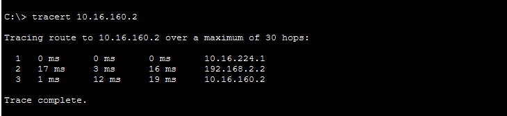

1. Kenapa router memilih jalur tunnel?
   Rute ke subnet Pelabuhan di R-PUSAT adalah static route dengan next hop `192.168.2.2` (Tunnel0). Static route memiliki Administrative Distance 1, lebih kecil daripada OSPF (110), sehingga selalu dipilih dibanding jalur biasa lewat L2 dan L6. Hal ini terlihat pada `tracert` yang hop keduanya adalah `192.168.2.2`.

2. Kenapa GRE saja tidak mengenkripsi data?
   GRE hanya melakukan encapsulation, yaitu membungkus paket asli dengan header GRE dan header IP baru. GRE tidak punya mekanisme kerahasiaan, sehingga isi paket masih bisa dibaca router yang dilewati, yaitu R-UTARA.

#### Konfigurasi IPsec

Agar trafik di dalam tunnel terenkripsi, GRE diamankan dengan IPsec. Aktivasi diawali dengan mengaktifkan license `securityk9` (`license boot module c2900 technology-package securityk9`), lalu `write memory` dan `reload`. Konfigurasi di R-PUSAT:

```
crypto isakmp policy 10
 encryption aes 128
 hash sha
 authentication pre-share
 group 2
crypto isakmp key K2SmartCity address 10.16.243.54
crypto ipsec transform-set TS esp-aes esp-sha-hmac
access-list 101 permit gre host 10.16.243.37 host 10.16.243.54
crypto map CMAP 10 ipsec-isakmp
 set peer 10.16.243.54
 set transform-set TS
 match address 101
interface Serial0/1/0
 crypto map CMAP
```

`crypto isakmp policy` mengatur negosiasi fase 1 (IKE) dengan enkripsi AES 128, hash SHA, autentikasi pre-shared key, dan Diffie-Hellman group 2. `crypto isakmp key` menetapkan kunci bersama untuk peer. `transform-set TS` menentukan fase 2, yaitu ESP dengan enkripsi AES dan autentikasi SHA-HMAC. ACL 101 menentukan trafik yang dienkripsi, yaitu hanya GRE antara dua ujung tunnel. `crypto map CMAP` menggabungkan peer, transform-set, dan ACL, lalu dipasang pada interface yang menjadi tunnel source.

Di R-PELABUHAN konfigurasinya sama, tetapi peer, key, dan ACL dibalik (peer `10.16.243.37`, ACL `permit gre host 10.16.243.54 host 10.16.243.37`), dan crypto map dipasang di Serial0/0/0.

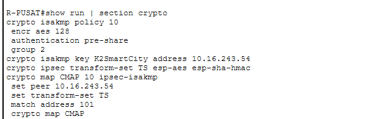
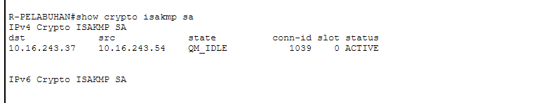
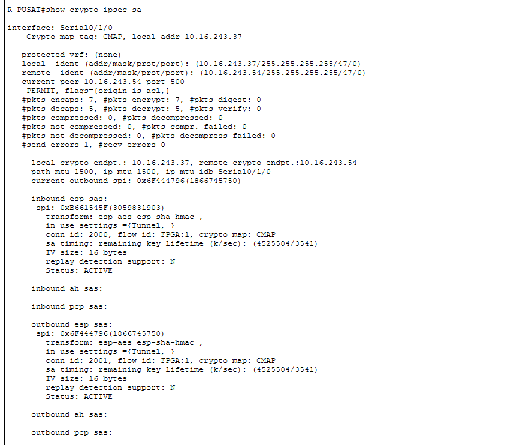

`show crypto isakmp sa` menunjukkan state `QM_IDLE`, dan `show crypto ipsec sa` menunjukkan `#pkts encrypt` dan `#pkts decrypt` bertambah setelah ping Balai Kota ke Pelabuhan. Artinya paket GRE di L2 dan L6 sudah dibungkus ESP, sehingga R-UTARA hanya meneruskan tanpa bisa membaca isinya.

#### Pengujian

1. Tunnel0 aktif. 
Tunnel0 di R-PUSAT (`192.168.2.1`) dan R-PELABUHAN (`192.168.2.2`) berstatus `up/up`.

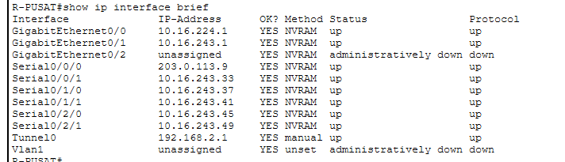
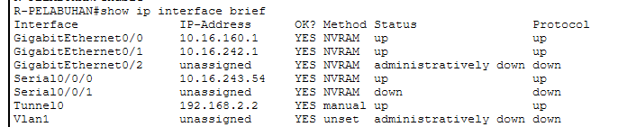

2. Trafik lewat tunnel.
   Ping dari PC-PEGAWAI-BALAIKOTA ke PC-SCADA-PELABUHAN (`10.16.160.2`) berhasil. Pada `tracert`, hop kedua adalah `192.168.2.2`, bukan alamat link L2/L6, sehingga trafik terbukti melewati tunnel. Rute ke subnet Pelabuhan di R-PUSAT juga mengarah ke `192.168.2.2`.

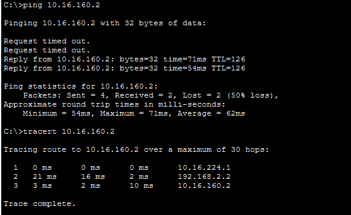

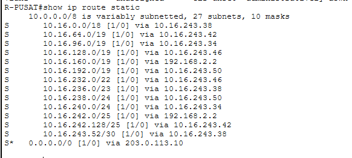

3. Isi paket (Simulation).
   Di R-PUSAT (Inbound) paket masih asli (ICMP). Setelah keluar (Outbound), paket dibungkus header IP baru `10.16.243.37` ke `10.16.243.54` dengan protokol ESP. Di R-UTARA hanya terlihat alamat ujung tunnel dan isi terenkripsi.

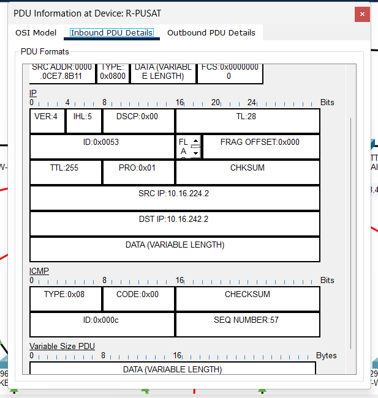

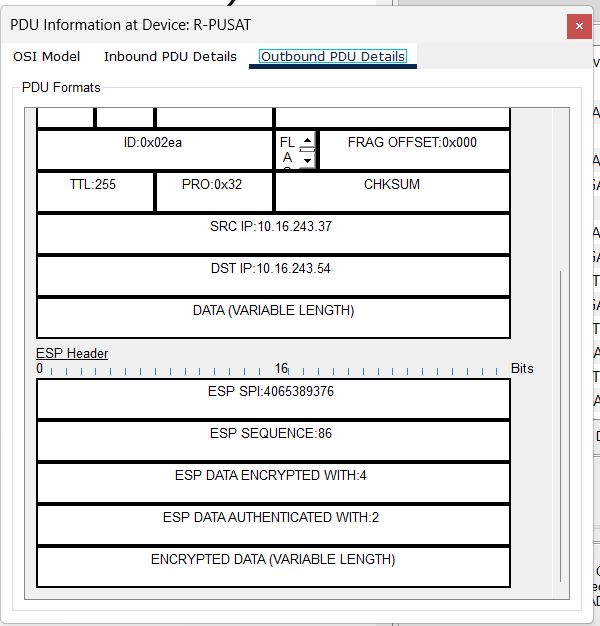

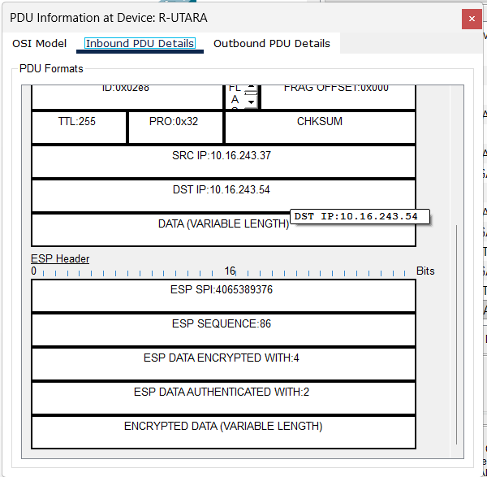

4. IPsec aktif.
    `show crypto isakmp sa` menunjukkan `QM_IDLE`, dan `show crypto ipsec sa` menunjukkan `#pkts encaps` dan `#pkts decaps` bertambah setelah ping.


### 7. Dynamic Routing OSPF

Pada nomor ini, seluruh static route antar-router diganti dengan OSPF dan dikerjakan pada file terpisah `K2_VLSM_OSPF.pkt`, yaitu salinan dari file utama. Semua router dimasukkan ke satu domain OSPF (process 1, area 0) supaya setiap router bisa saling bertukar informasi rute secara otomatis.

Langkah pertama adalah menambahkan link cadangan L7 antara R-DC (Serial0/0/1, `10.16.243.57`) dan R-UTARA (Serial0/1/0, `10.16.243.58`). Link ini memakai subnet `10.16.243.56/30` yang belum dipakai oleh L1 sampai L6, sehingga tidak terjadi bentrok alamat. Sisi R-DC bertindak sebagai DCE sehingga diberi clock rate.

Setelah link L7 aktif, seluruh static route antar-router dihapus, lalu OSPF dikonfigurasi di setiap router dengan pola yang sama: tiap router diberi router-id unik, kemudian LAN dan link backbone miliknya diumumkan ke area 0. Agar router tidak mengirim pesan OSPF ke arah pengguna, seluruh interface dijadikan passive secara default, dan hanya interface backbone antar-router yang dibuka kembali. Sebagai contoh, konfigurasi R-BARAT:

```
router ospf 1
 router-id 7.7.7.7
 passive-interface default
 no passive-interface Serial0/0/0
 network 10.16.192.0 0.0.31.255 area 0
 network 10.16.238.0 0.0.0.255 area 0
 network 10.16.243.48 0.0.0.3 area 0
```

Untuk jalur keluar ke internet, default route hanya dikonfigurasi di R-PUSAT (menuju R-ISP) dan disebarkan ke seluruh router lain lewat OSPF dengan perintah `default-information originate`. Dengan begitu router lain menerimanya secara otomatis sebagai rute `O*E2 0.0.0.0/0`. Link R-PUSAT ke ISP sengaja tidak dimasukkan ke OSPF sehingga R-ISP tidak mendapat rute ke alamat privat.

Untuk rute Pelabuhan di R-PUSAT dan rute Balai Kota di R-PELABUHAN dibiarkan tetap static. Hal ini karena soal nomor 6 mewajibkan trafik Balai Kota ke Pelabuhan melewati tunnel GRE, dan static route (AD 1) lebih diprioritaskan daripada OSPF (AD 110). Tunnel0 juga tidak diikutkan ke OSPF untuk menghindari recursive routing.

#### Pengujian

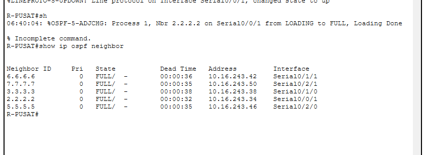

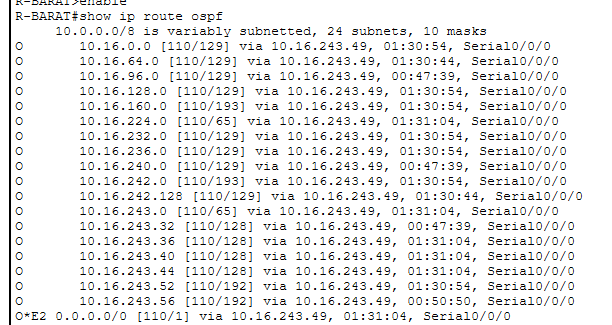

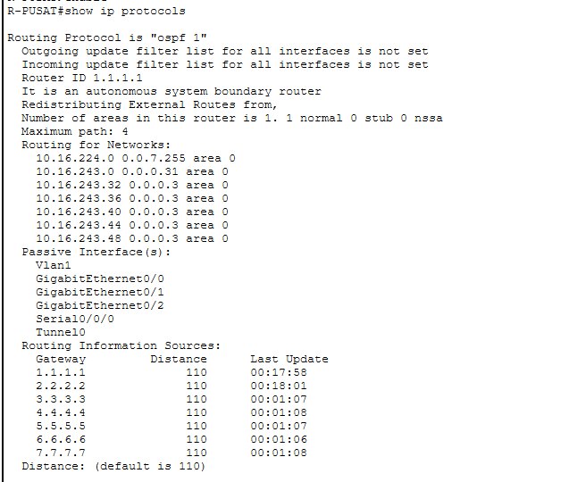

Pengujian failover dilakukan untuk membuktikan konektivitas pulih otomatis saat link backbone putus. Dari PC Pegawai dijalankan `ping -t` ke Server DC (`10.16.240.2`), lalu link utama L1 (R-PUSAT ke R-DC) dimatikan lewat Serial0/0/1 di R-PUSAT. Pada kondisi normal, trafik menuju R-DC melewati L1 (`10.16.243.34`) dengan cost 65. Setelah L1 putus, OSPF menghitung ulang jalur dan trafik berpindah melalui R-UTARA (`10.16.243.38`) lalu link cadangan L7 (`10.16.243.57`) dengan cost 129. Ping sempat *Request timed out* beberapa saat, kemudian pulih sendiri tanpa perubahan konfigurasi manual. Setelah link L1 dinyalakan kembali, rute otomatis kembali melalui L1.

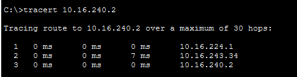

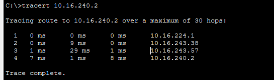

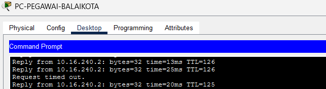

Pengujian failover memakai L1, bukan L2, karena L2 adalah sumber tunnel GRE di R-PUSAT sehingga memutusnya akan ikut menjatuhkan tunnel.

### 8. Layanan Aplikasi Smart City

Domain internal yang dipakai adalah `k2.smartcity.lab`. DNS, FTP, dan Email ditempatkan di Server DC (`10.16.240.2`) karena DC adalah pusat data dan storage rekaman CCTV. Web ditempatkan di Server Balai Kota (`10.16.243.2`) sesuai topologi. Semua layanan dikonfigurasi lewat menu **Services** pada masing-masing server, dan DNS server `10.16.240.2` dibagikan ke klien melalui DHCP.

a. DNS Pada Server DC
Pertama-tama Services > DNS pada Server DC dinyalakan, lalu dibuat tiga A record: `www.k2.smartcity.lab` ke `10.16.243.2`, serta `ftp.k2.smartcity.lab` dan `mail.k2.smartcity.lab` ke `10.16.240.2`.

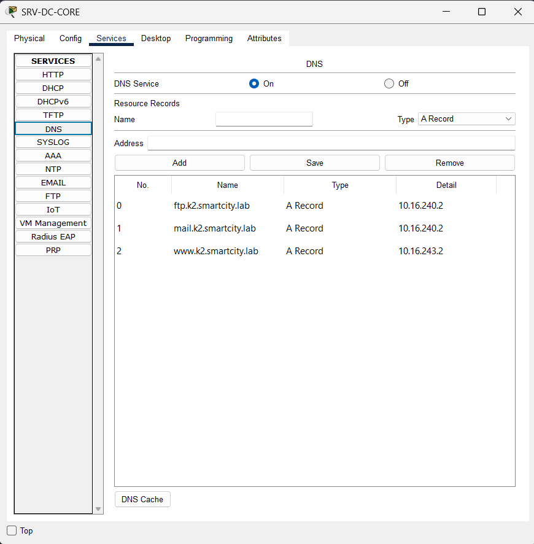

b. Web 
Pada Server Balai Kota, Services > HTTP dinyalakan dan `index.html` diubah menjadi halaman berjudul "Portal Smart City Surabaya" yang mencantumkan "Kelompok 2". Halaman dibuka lewat nama domain `www.k2.smartcity.lab`, bukan IP.

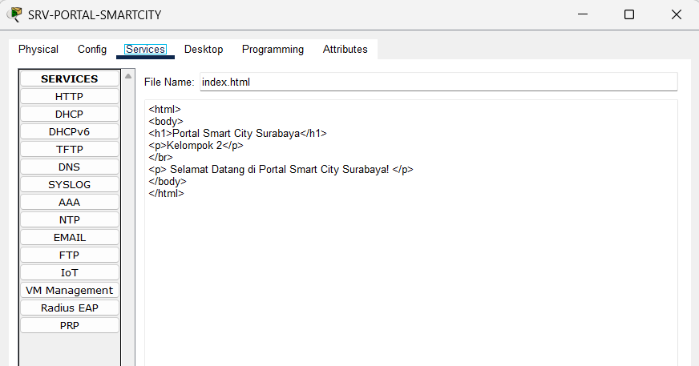

c. FTP
Pada Server DC, Services > FTP dinyalakan dan dibuat akun `cctv` dengan permission penuh (Write, Read, Delete, Rename, List). Dari PC-CCTV-KOTA dibuat file `rekaman.txt` lewat Text Editor, lalu diunggah dengan perintah `ftp ftp.k2.smartcity.lab`, login `cctv`, `put rekaman.txt`, dan `dir` untuk memastikan file tersimpan.

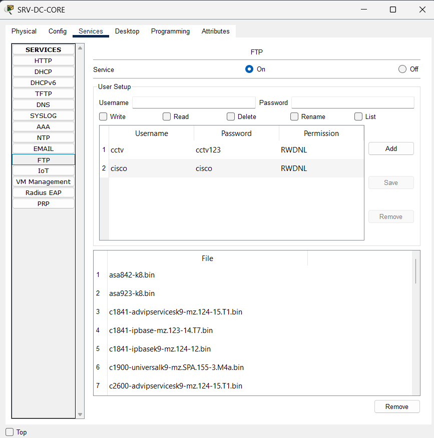
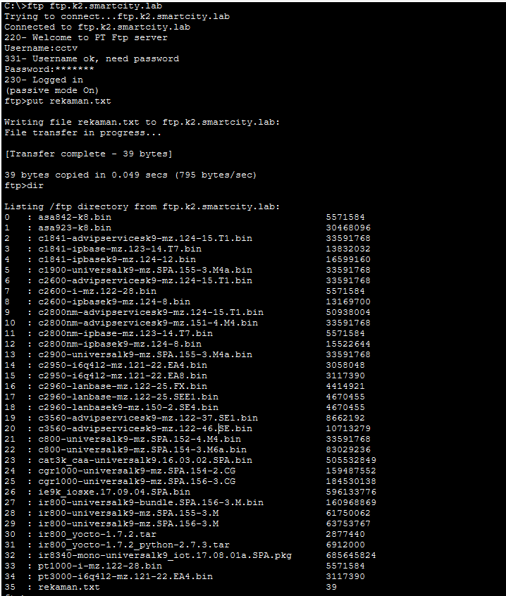

d. Email 
Pada Server DC, Services > EMAIL dinyalakan (SMTP dan POP3), domain `k2.smartcity.lab` di-Set, lalu dibuat user `pegawai` dan `pelabuhan`. Pada PC Pegawai Balai Kota dan PC Kantor Pelabuhan, Configure Mail diisi dengan alamat `user@k2.smartcity.lab`, incoming dan outgoing server `mail.k2.smartcity.lab`, serta username dan password sesuai akun di server. Pengujian dilakukan dua arah: kirim dari Pegawai ke Pelabuhan lalu Receive, kemudian sebaliknya.
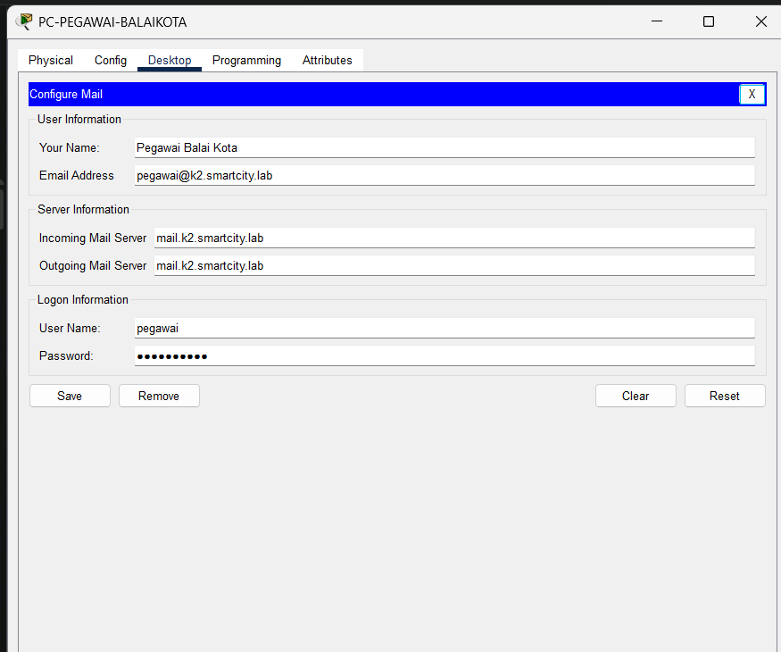

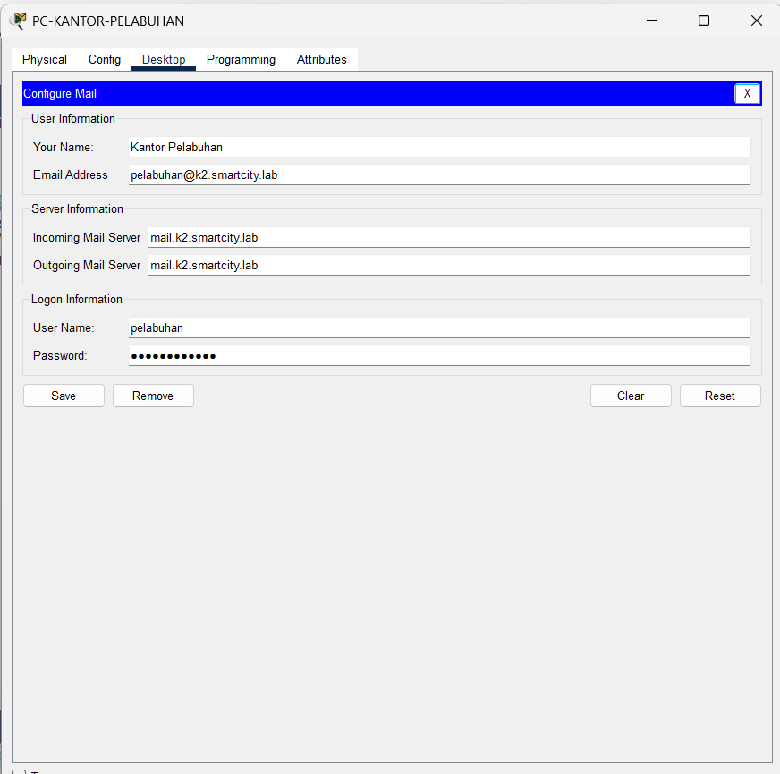

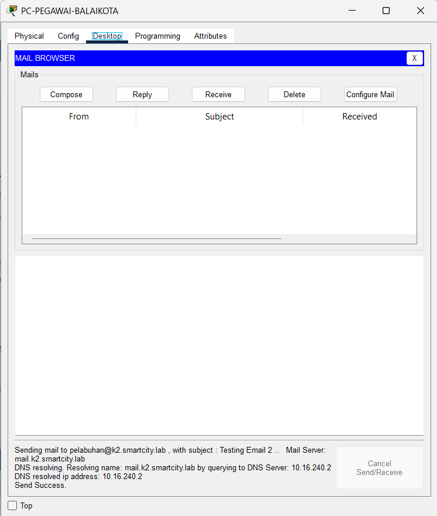
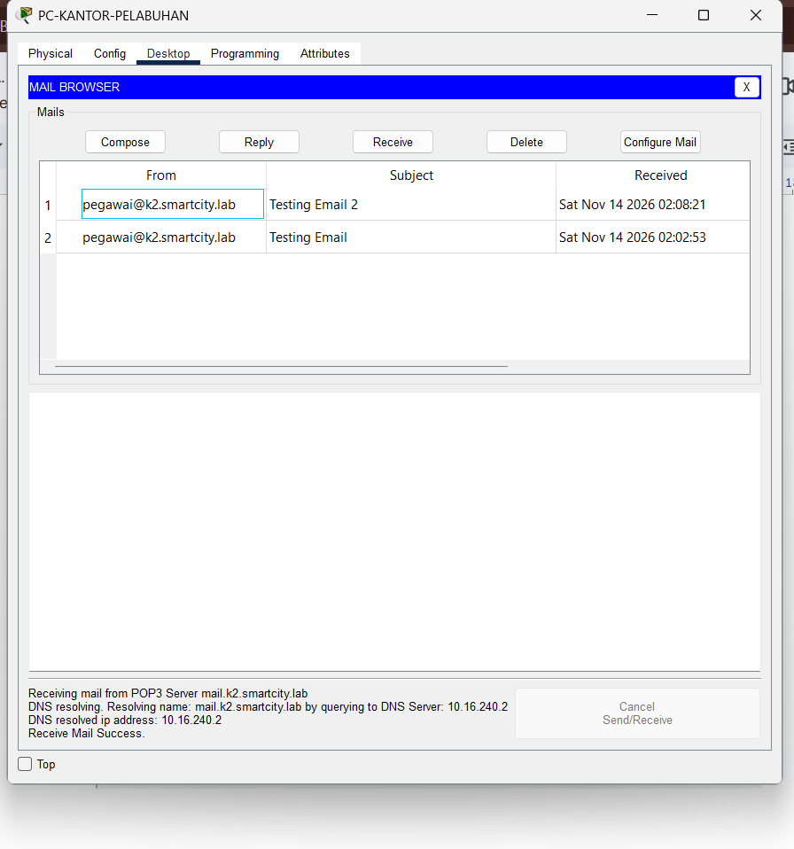

#### Pengujian

a. DNS
 `nslookup` untuk `www`, `ftp`, dan `mail` dijalankan dari dua wilayah berbeda, yaitu Balai Kota dan Pelabuhan. Ketiganya mengembalikan IP yang benar.

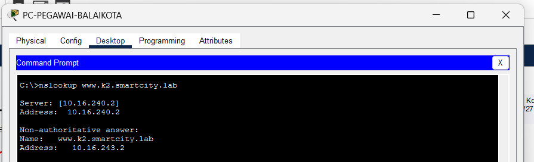

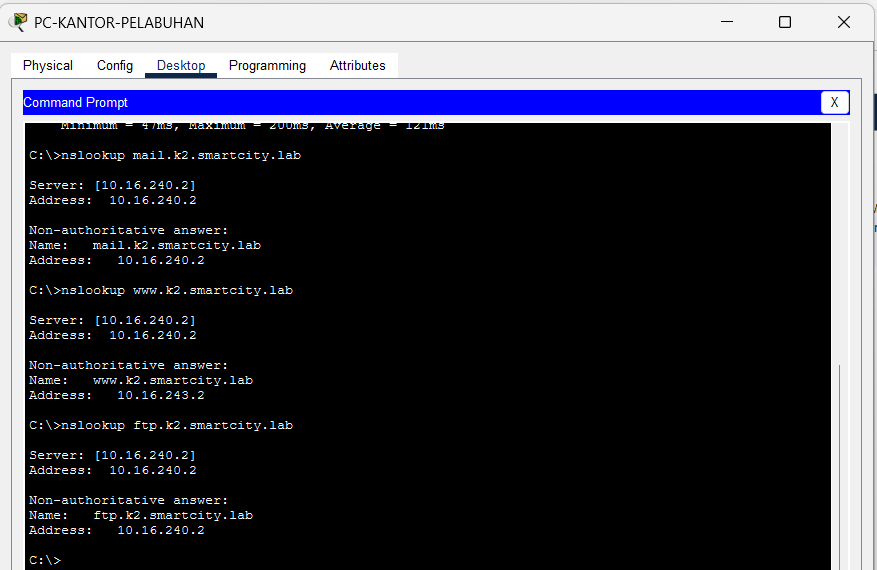

b. Web

Halaman "Portal Smart City Surabaya" dibuka memakai nama domain `www.k2.smartcity.lab`, bukan IP, dari dua wilayah.

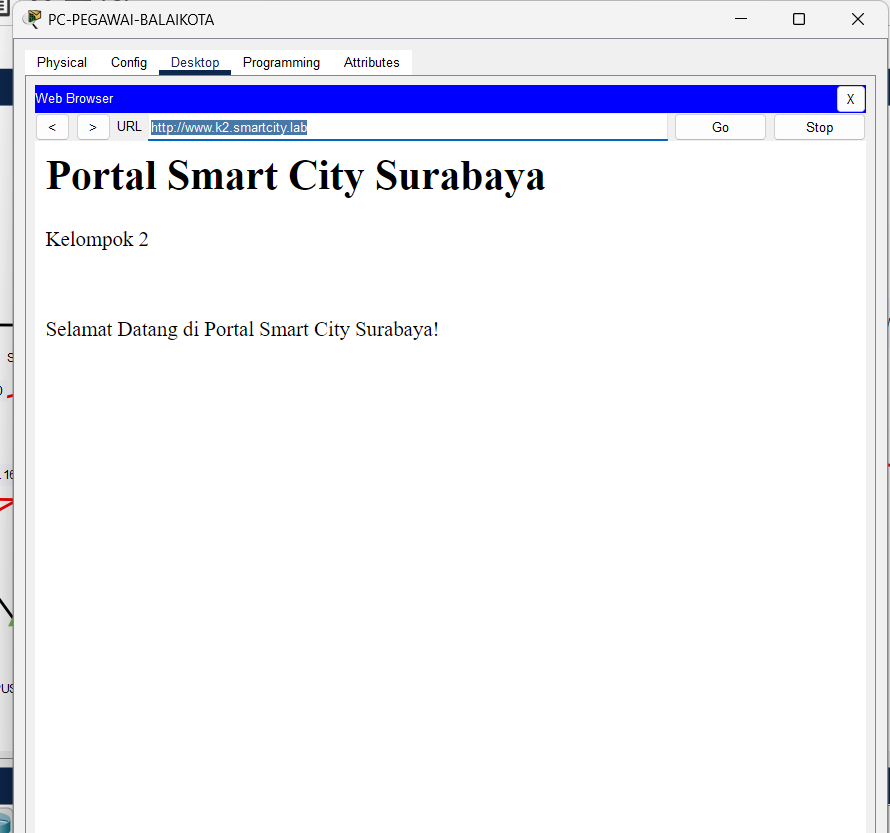
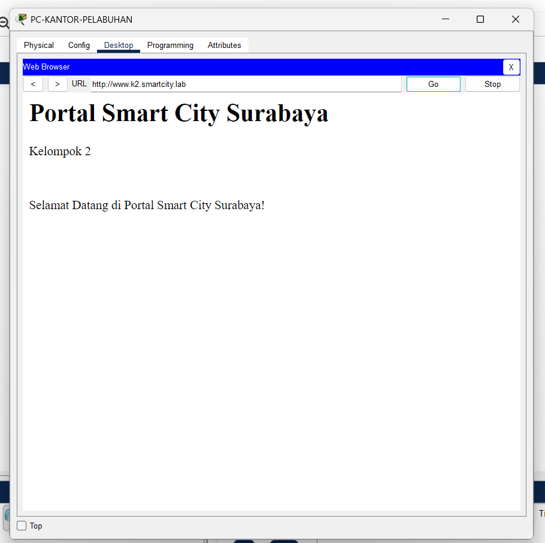

c. FTP
 PC-CCTV-KOTA login sebagai `cctv`, mengunggah `rekaman.txt` dengan `put`, dan file muncul pada `dir`.


d. Email
 Pengujian dua arah. Email dari Pegawai ke Pelabuhan berhasil dikirim dan diterima, begitu juga sebaliknya.


